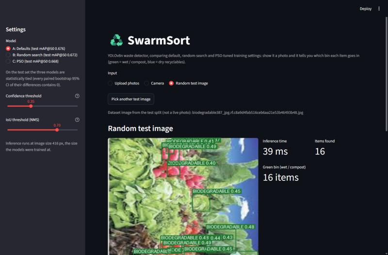
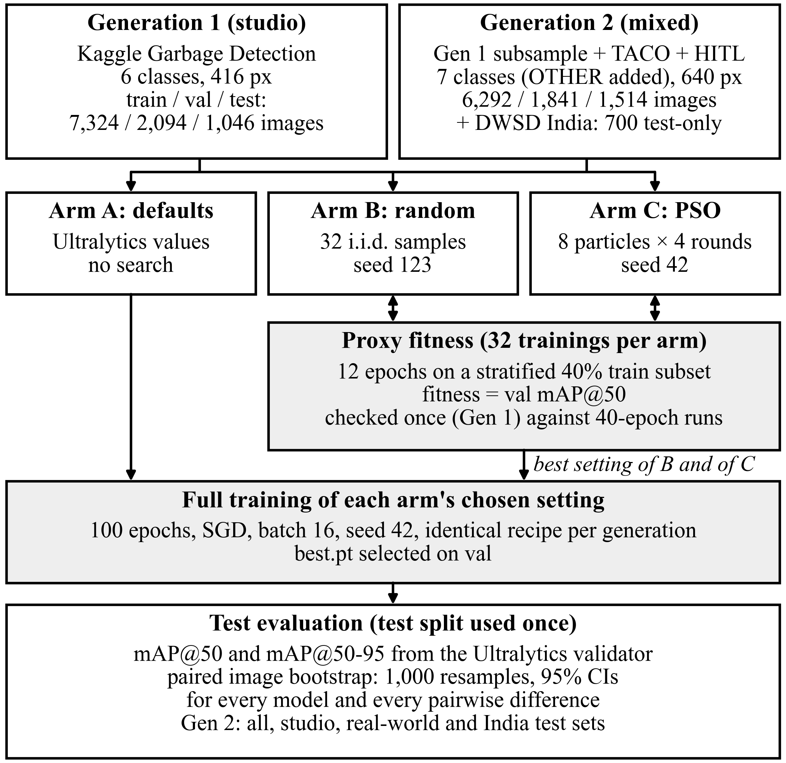
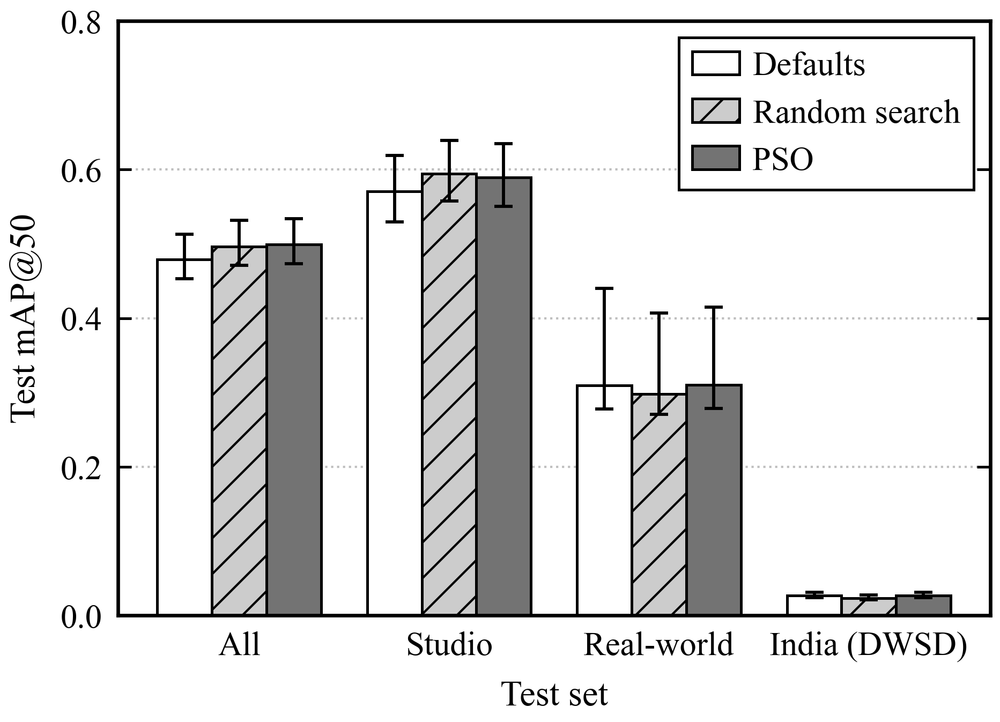
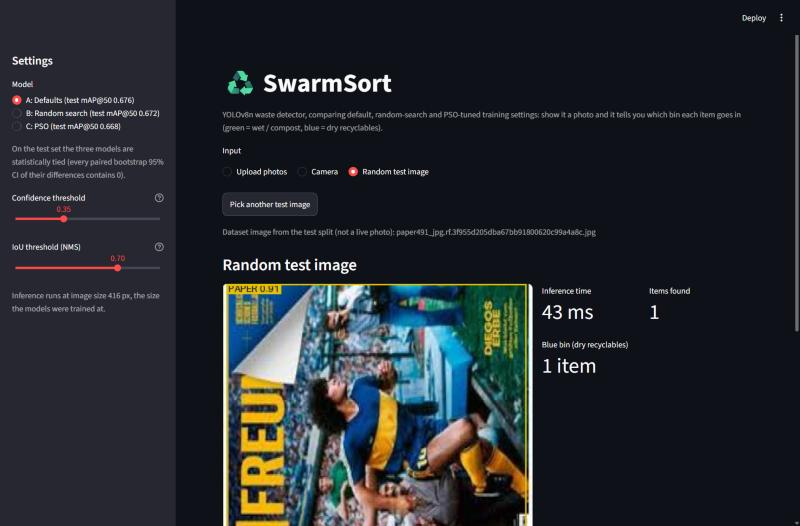

# SwarmSort: Particle Swarm Optimization for Waste Detection

SwarmSort is our Soft Computing course project (Semester V, Unit V: swarm intelligence). We train a YOLOv8n waste detector and tune its training hyperparameters with a PSO that we wrote ourselves, and then check honestly whether the PSO was worth it by comparing it with random search and with the default settings.

You give the app a photo of waste, it draws a box around each item, labels it (biodegradable, cardboard, glass, metal, paper, plastic or other) and tells which bin it should go in: green for wet waste, blue for dry recyclables and a reject bin for the rest.

<p align="center">
  
</p>

(The screenshot is from the first version of the app. The current one also has a generation switch and the reject bin.)

## Short summary

We did the whole experiment two times, we call them Generation 1 and Generation 2.

| | Generation 1 | Generation 2 |
|---|---|---|
| Training data | Kaggle garbage-detection (studio photos), 7,324 train / 2,094 val | Gen 1 subsample + TACO + HITL Recycling, 6,292 train / 1,841 val |
| Test sets | 1,046 studio images | all (1,514), studio (1,046), real_world (468), india (700, DWSD, test only) |
| Classes | 6: BIODEGRADABLE, PAPER, CARDBOARD, PLASTIC, METAL, GLASS | 7 (previous six + OTHER) |
| Model | YOLOv8n at 416 px | YOLOv8n at 640 px |
| Test mAP@50 (defaults / random / PSO) | 0.676 / 0.672 / 0.668 | all: 0.479 / 0.497 / 0.500, real_world: 0.310 / 0.298 / 0.310, india: 0.027 / 0.023 / 0.027 |
| What we found | All three are tied | Random search and PSO both beat the defaults by about 0.02, but they tie with each other |

The main things we learned:

- PSO never really beat random search. With the same budget of 32 short trainings both of them end up at almost the same place.
- On clean studio data the Ultralytics defaults were already very good, so tuning gave nothing.
- Data matters much more than the optimizer. Adding real-world photos took real-world mAP@50 from about 0.04–0.10 (Gen 1 models) to about 0.34–0.35 (Gen 2 models) on the same test images. The price was around 0.08–0.10 lower mAP@50 on studio photos.
- On Indian street photos (DWSD) every model fails (about 0.02–0.03). We never trained on Indian images, and the DWSD boxes are made from masks so touching items get merged in one big box.

Speed is about 31 ms per image on a laptop CPU for Gen 1 and 8–9 ms on a Tesla T4 for Gen 2.

## Why we made this

Under India's Solid Waste Management Rules, 2016 every household have to separate wet waste, dry recyclables and domestic hazardous waste at source. In practice this is done by hand and often not done properly. A small camera model that can recognise each item and tell the bin could help, but it has to be light enough for cheap hardware.

Our base paper is Majchrowska et al. (2022). They use two networks, an EfficientDet-D2 to find the litter and an EfficientNet-B2 to classify each crop, and the hyperparameters are picked by hand. We wanted to try a single-stage detector (YOLOv8n does both in one pass) and see if a proper search over the hyperparameters improves it.

We picked PSO because all six hyperparameters are continuous, each evaluation is a full training run so we can afford only a few dozen of them, and PSO has very few settings of its own (w, c1, c2). It is also the algorithm from our syllabus.

## How it works

<p align="center">
  
</p>

There are three "arms":

- **Arm A**: Ultralytics default hyperparameters, no search
- **Arm B**: best of 32 random samples (seed 123)
- **Arm C**: PSO with 8 particles × 4 rounds = 32 evaluations (seed 42)

**Search space.** Same for both searches and both generations (`src/search_space.py`):

| Hyperparameter | Range | Scale | Default |
|---|---|---|---|
| `lr0` | 1e-4 to 1e-2 | log10 | 0.01 |
| `lrf` | 0.01 to 0.2 | linear | 0.01 |
| `momentum` | 0.60 to 0.98 | linear | 0.937 |
| `weight_decay` | 1e-5 to 1e-3 | log10 | 0.0005 |
| `mosaic` | 0 to 1 | linear | 1.0 |
| `scale` | 0.2 to 0.8 | linear | 0.5 |

**PSO.** `src/pso.py` is a plain inertia-weight PSO in about 70 lines of numpy:

```
v = w*v + c1*r1*(pbest - x) + c2*r2*(gbest - x)
x = x + v
```

c1 = c2 = 1.5, w goes from 0.9 down to 0.4, velocity is limited to ±20% of each range and positions are clipped to the bounds. It has an ask/tell interface so the same class is used for the benchmark functions (Sphere, Rastrigin) and for the real search.

**Proxy fitness.** A full training takes 1–2 hours on a Kaggle T4, so we can't do 64 of them. Each candidate is scored with a short training instead: 12 epochs on a stratified 40% of the train split, and the fitness is val mAP@50. Before trusting this we checked it in Gen 1 with 8 configurations trained both ways (proxy and 40 epochs). Spearman correlation came out 0.976, and our pass mark decided beforehand was 0.6.

**Full training.** The winner of each arm is trained for 100 epochs with the same recipe (SGD, batch 16, seed 42, `best.pt` picked on val). Note that `optimizer=auto` in Ultralytics ignores `lr0` and `momentum`, so SGD is set explicitly.

**Evaluation.** The test split is used only once. `src/evaluate.py` runs the Ultralytics validator and then a paired bootstrap (1,000 resamples of the test images, same resample for every model) to get 95% confidence intervals for each model and for each difference. We call a difference significant only when its interval does not include 0.

### About the data

- The Kaggle dataset's own train/valid/test folders turned out to be split by class (for example the test folder has no glass at all), so we pooled everything and re-split it 70/20/10 stratified by class. The split is saved in `configs/split.csv`.
- The split is duplicate-aware. Copies and near copies of a photo (same bytes, same Roboflow source or very close dHash) always stay in the same split, so nothing leaks from train to test.
- Gen 2 is built by `src/build_dataset.py` from four sources in four different formats (YOLO, COCO, Supervisely JSON and semantic masks), configured in `configs/gen2/sources.yaml`.
- OTHER is a new class in Gen 2 for things like cigarette butts and mixed litter. It is the weakest class (AP@50 around 0.05–0.06).
- DWSD (Kolkata streets) gives masks and not boxes, so each connected region becomes one box. Its published class table also did not match the masks so we had to work out the mapping from the images. It is used only for testing.

More details, including all the things that went wrong (two Kaggle sessions froze and we lost about 24 GPU hours), are in [docs/EVOLUTION.md](docs/EVOLUTION.md).

## Results

All numbers come from the JSON files in `results/` and `results/gen2/`.

### Generation 1 (studio test split, 1,046 images)

| Arm | test mAP@50 [95% CI] | test mAP@50-95 [95% CI] | Precision | Recall |
|---|---|---|---|---|
| A: Defaults | 0.676 [0.639, 0.722] | 0.474 [0.441, 0.518] | 0.747 | 0.581 |
| B: Random search | 0.672 [0.634, 0.717] | 0.475 [0.441, 0.519] | 0.746 | 0.587 |
| C: PSO | 0.668 [0.627, 0.717] | 0.471 [0.437, 0.516] | 0.747 | 0.586 |

| Pair | Δ mAP@50 [95% CI] | Verdict |
|---|---|---|
| B − A | −0.004 [−0.016, +0.009] | not significant |
| C − A | −0.008 [−0.021, +0.007] | not significant |
| C − B | −0.004 [−0.015, +0.007] | not significant |

On the proxy both searches were ahead of the defaults (0.4995 and 0.4953 against 0.4765) but after 100 epochs that small lead was gone.

### Generation 2 (test mAP@50 [95% CI])

| Arm | all (1,514) | studio (1,046) | real_world (468) | india (700) |
|---|---|---|---|---|
| A: Defaults | 0.479 [0.453, 0.513] | 0.571 [0.529, 0.619] | 0.310 [0.278, 0.440] | 0.027 [0.024, 0.031] |
| B: Random search | 0.497 [0.471, 0.531] | 0.595 [0.557, 0.639] | 0.298 [0.271, 0.407] | 0.023 [0.021, 0.027] |
| C: PSO | 0.500 [0.474, 0.534] | 0.590 [0.550, 0.635] | 0.310 [0.279, 0.415] | 0.027 [0.024, 0.031] |

Differences (bold = significant):

| Pair | all | studio | real_world | india |
|---|---|---|---|---|
| B − A | **+0.017** | **+0.024** | −0.012 | **−0.003** |
| C − A | **+0.020** | **+0.019** | +0.001 | +0.000 |
| C − B | +0.003 | −0.005 | +0.013 | **+0.003** |

<p align="center">
  
</p>

The real_world intervals are wide because BIODEGRADABLE has only one box in that set. The significant differences on india are a few thousandths on scores near zero, so they don't mean anything in practice. Full tables with intervals are in [results/gen2/test_domains.md](results/gen2/test_domains.md).

### Gen 1 vs Gen 2 on the same images

To compare the two generations fairly all six models were scored on the same test images with only the 6 shared classes (`src/compare_generations.py`).

| Model | real_world mAP@50 | studio mAP@50 |
|---|---|---|
| Gen 1 A / B / C | 0.047 / 0.038 / 0.096 | 0.676 / 0.672 / 0.669 |
| Gen 2 A / B / C | 0.353 / 0.338 / 0.352 | 0.571 / 0.595 / 0.590 |

Every Gen 2 model is significantly better than every Gen 1 model on real-world photos, and every Gen 1 model is significantly better on studio photos.

## Demo app

```bash
.venv/Scripts/python -m streamlit run app/app.py
```

It works straight from a fresh clone because all six trained models are in the repo (`app/models/` for Gen 1 and `app/models/gen2/` for Gen 2). You can choose the generation and the arm, upload photos or use the camera, and change the confidence and IoU thresholds. For each detected item the app shows the bin and a small disposal tip.

<p align="center">
  
</p>

Bin rules (in `app/helpers.py`):

| Item | Bin |
|---|---|
| BIODEGRADABLE | Green bin (wet / compost) |
| PAPER, CARDBOARD, PLASTIC, METAL, GLASS | Blue bin (dry recyclables) |
| OTHER (Gen 2 only) | Reject bin |

## Setup

```bash
git clone https://github.com/CrossAnushka/Particle-Swarm-Optimization-for-Waste-Detection.git
cd Particle-Swarm-Optimization-for-Waste-Detection
python -m venv .venv
.venv/Scripts/python -m pip install -r requirements.txt     # Linux/macOS: .venv/bin/python

.venv/Scripts/python -m streamlit run app/app.py            # demo, no dataset or GPU needed
.venv/Scripts/python -m unittest discover -s tests -v       # tests
```

Some tests do a short CPU training. Set `SWARMSORT_SKIP_SLOW=1` if you want to skip those.

## Folder structure

```
app/          Streamlit app, helpers and the six trained models
configs/      split.csv (Gen 1 split) and gen2/ (sources, arms)
docs/         EVOLUTION.md, FUTURE_WORK.md, RELATED_WORK.md, images
notebooks/    Kaggle notebooks (phase*.ipynb for Gen 1, gen2/ for Gen 2)
results/      all result JSONs, comparison tables and plots
src/          dataset checks and builder, PSO, search, training, evaluation
tests/        unit tests
report/       Generation 1 project report
paper/        research paper (LaTeX, figures and the scripts that draw them)
```

## Reproducing the experiment

All GPU work was done in Kaggle notebooks on a T4 (GPU T4 x2, Internet on, run with Save Version → Save & Run All). Everything else runs on a laptop.

**Generation 1**

1. Download the Kaggle dataset into the project folder and run the checks (this reuses `configs/split.csv`):
   ```bash
   .venv/Scripts/python src/verify_dataset.py --root "GARBAGE CLASSIFICATION"
   ```
2. Baseline and proxy check on Kaggle: `phase2a_baseline.ipynb`, `phase2b_proxy_check.ipynb`
3. PSO sanity check on a laptop:
   ```bash
   .venv/Scripts/python src/pso_benchmark.py
   ```
4. The two searches on Kaggle: `phase4a_pso_search.ipynb`, `phase4b_random_search.ipynb` (about 2 hours each)
5. Full training of both winners on Kaggle: `phase5a_train_arm_b.ipynb`, `phase5b_train_arm_c.ipynb`
6. Download the weights and results, then evaluate locally:
   ```bash
   .venv/Scripts/python src/evaluate.py
   ```

If a Kaggle session dies in the middle of a search, attach the output of the failed version and run again. `search.py` replays its log and continues from the first missing evaluation.

One small thing: a `.pt` file downloads from Kaggle as a `.zip`. Just rename it back to `best.pt`, don't unzip it.

**Generation 2**

Run the notebooks in `notebooks/gen2/` in order, `g2_0` (dataset build) to `g2_7` (Gen 1 vs Gen 2 comparison). The run order, which outputs to attach and the troubleshooting notes are in [notebooks/gen2/README.md](notebooks/gen2/README.md). DWSD is not on Kaggle, so download it from Mendeley (`gr99ny6b8p`) and upload it as a private dataset if you want the india test set.

## Limitations

- Each arm was trained with one seed only, so we did not measure run-to-run noise.
- The real-world test set is small (468 images) and has a single BIODEGRADABLE box.
- India results are close to zero, we need Indian training data with per-item boxes.
- OTHER class is very weak.
- 32 evaluations in 6 dimensions is a small search and the 12-epoch proxy probably favours fast learners.

The longer list of ideas is in [docs/FUTURE_WORK.md](docs/FUTURE_WORK.md).

## References

1. S. Majchrowska et al., "Deep learning-based waste detection in natural and urban environments," *Waste Management*, vol. 138, pp. 274–284, 2022. (base paper)
2. J. Kennedy and R. Eberhart, "Particle swarm optimization," *Proc. IEEE ICNN*, 1995.
3. Y. Shi and R. Eberhart, "A modified particle swarm optimizer," *Proc. IEEE Int. Conf. Evolutionary Computation*, 1998.
4. J. Bergstra and Y. Bengio, "Random search for hyper-parameter optimization," *JMLR*, vol. 13, pp. 281–305, 2012.
5. G. Jocher, A. Chaurasia and J. Qiu, "Ultralytics YOLOv8," 2023. https://github.com/ultralytics/ultralytics
6. B. Efron and R. J. Tibshirani, *An Introduction to the Bootstrap*, Chapman & Hall, 1993.
7. Ministry of Environment, Forest and Climate Change, Government of India, "Solid Waste Management Rules, 2016."
8. P. F. Proença and P. Simões, "TACO: Trash Annotations in Context for litter detection," arXiv:2003.06975, 2020.
9. Ali et al., Dense Waste Segmentation Dataset (DWSD), *Data in Brief*, 2025.

More papers are listed in [docs/RELATED_WORK.md](docs/RELATED_WORK.md).

**Datasets**

- [Garbage Detection – 6 Waste Categories](https://www.kaggle.com/datasets/viswaprakash1990/garbage-detection) by viswaprakash1990, CC BY 4.0, via Kaggle
- [TACO](http://tacodataset.org/), via Kaggle `kneroma/tacotrashdataset`, CC BY 4.0
- [Recycling dataset](https://www.kaggle.com/datasets/humansintheloop/recycling-dataset) by Humans in the Loop, CC0, via Kaggle 
- [DWSD](https://data.mendeley.com/datasets/gr99ny6b8p) on Mendeley Data, CC BY 4.0 (only used as the India test set) via official site


## Authors

Anushka Gupta, Ayush Kumar and Vaishnavi

The project report for Generation 1 is in [report/SwarmSort_Report.docx](report/SwarmSort_Report.docx) and the research paper covering both generations is in [paper/](paper/).
